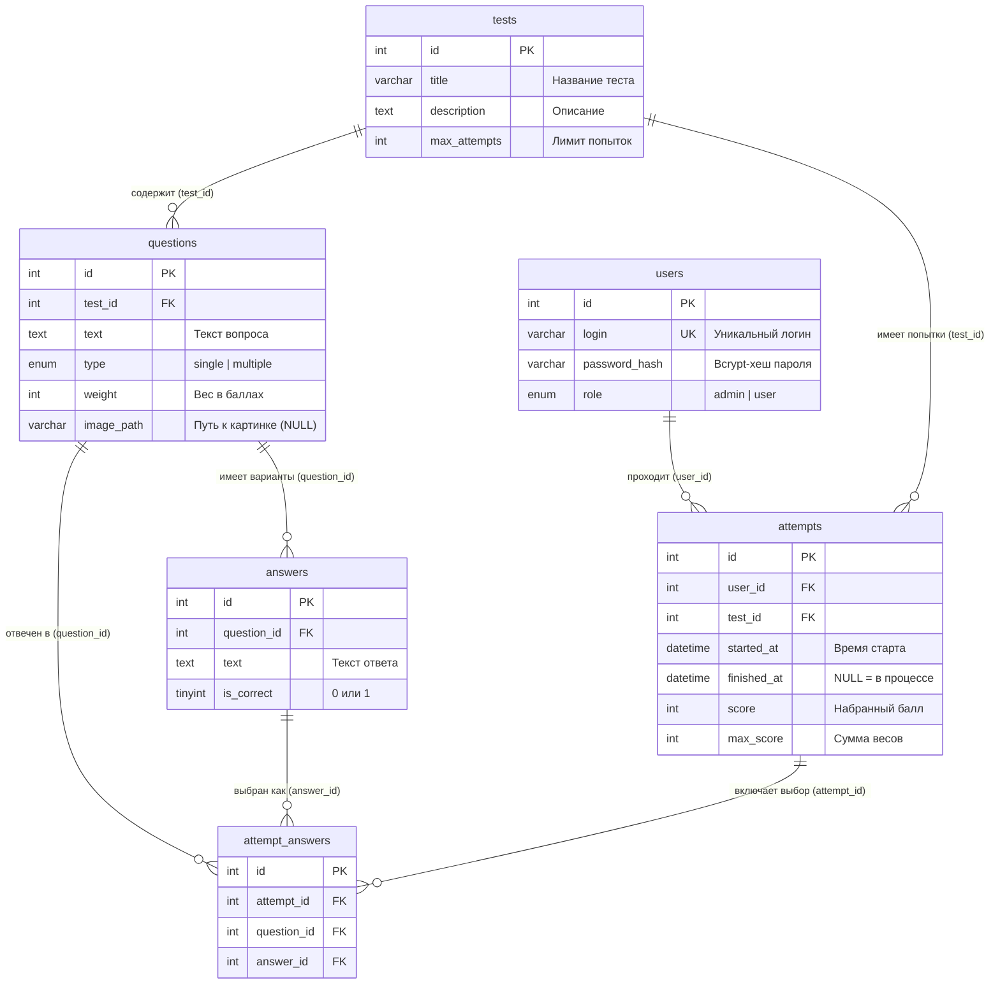
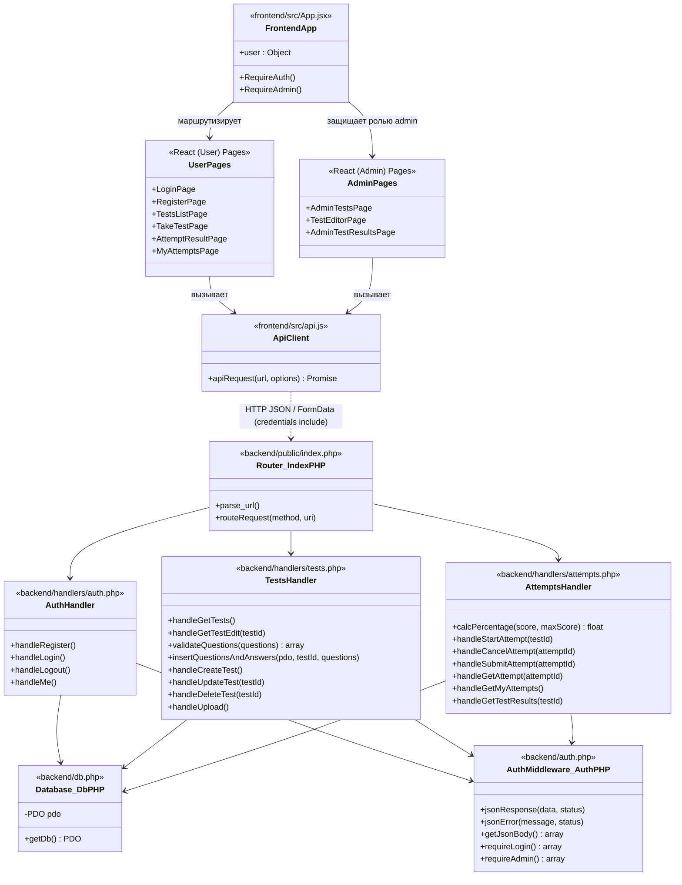
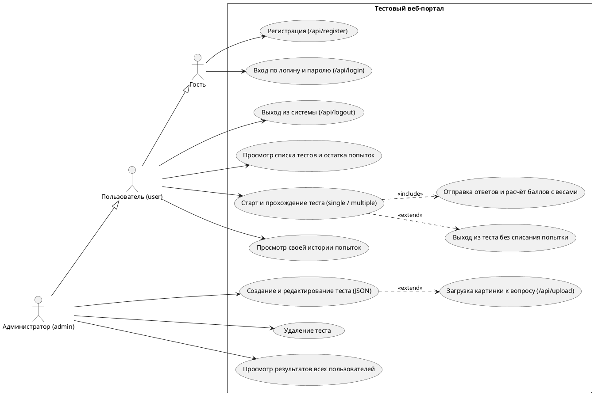
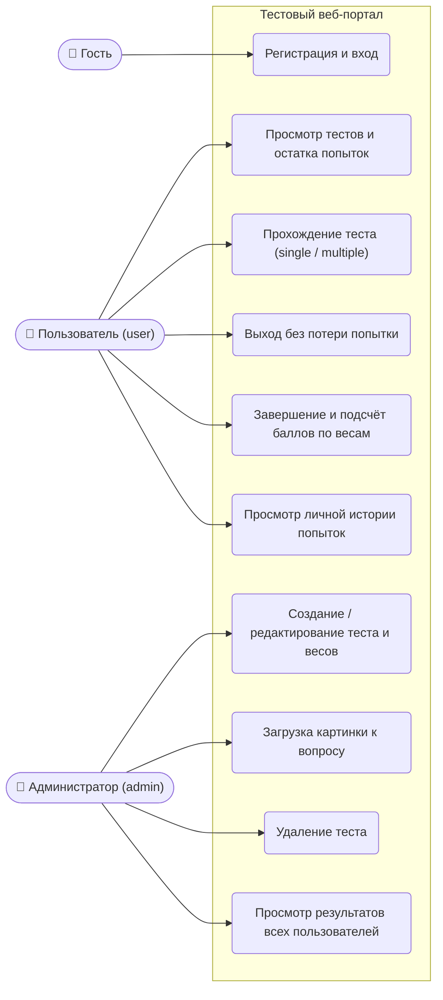

# Диаграммы проекта «Тестовый веб-портал»

## 1. ER-диаграмма базы данных (Mermaid)

Отражает 6 таблиц БД `testportal` (`db/schema.sql`) и связи `1:N` через внешние ключи с `ON DELETE CASCADE`.

---

## 2. Диаграмма классов и модулей системы (Mermaid Class Diagram)

Отражает реальную модульную структуру бэкенда на PHP (`backend/`) и клиентских компонентов React (`frontend/src/`).

---

## 3. Диаграмма прецедентов (Use Case Diagram)

### Вариант А: Код для PlantUML (классический стандарт UML)
Скопируй этот код на сайт `https://www.plantuml.com/plantuml/uml` или в плагин PlantUML в VS Code / Obsidian, чтобы сохранить PNG/SVG для печати.

### Вариант Б: Схема прецедентов в Mermaid (для просмотра прямо в Obsidian)

